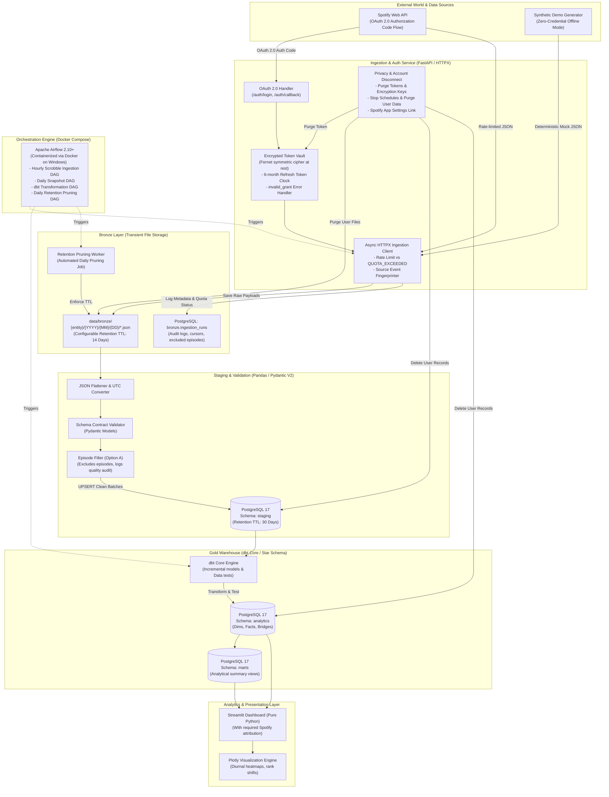

# SpotifyPulse Architecture Design Document (Final Architecture Audit)

## 1. System Overview & Vision

**SpotifyPulse** is a personal music analytics and data engineering platform. It is engineered to extract listening history, user taste profiles, and playlist evolutions from the Spotify Web API, land the payloads into a transient raw landing area (Bronze), clean and normalize them into relational staging structures (Staging), and model them into an enterprise Star Schema data warehouse (Gold) hosted on PostgreSQL 17 and transformed via dbt Core. Insights are presented through an interactive Streamlit and Plotly analytical application.

### Architectural Classification
SpotifyPulse is architected as a **layered data engineering platform** utilizing a Medallion-inspired processing pipeline:
* **Bronze**: Transient raw landing buffer for immutable JSON snapshots with automated retention pruning.
* **Staging**: Relational tables enforcing schema contracts, deduplication, and normalization.
* **Gold**: Kimball Star Schema dimensional data warehouse optimized for analytical queries.

> [!NOTE] Architecture Precision Note
> SpotifyPulse uses PostgreSQL 17, local partitioned file storage, dbt Core, and Python. It is an enterprise **layered data engineering architecture**, not a distributed data lakehouse (which would imply technologies like Apache Spark, Delta Lake, Apache Iceberg, or Trino).

---

## 2. Core Engineering Principles

* **Idempotency & Replayability**: Any pipeline execution can be safely re-run without creating duplicate records or corrupting warehouse state. Deduplication uses a deterministic **`source_event_fingerprint`** derived from source metadata.
* **Separation of Concerns**: Complete modular decoupling between API communication, authentication, ingestion, data transformation, warehousing, orchestration, and presentation.
* **Zero Secret Leakage**: Strict configuration management using environment variables and Pydantic Settings.
* **Resilience & Demo Mode**: Full platform capability operating either with live Spotify OAuth credentials or in an offline **Demo Mode** leveraging deterministic synthetic data generation.
* **Strict Terms & Privacy Compliance**: Multi-tier configurable data retention, complete user account disconnection and data purge across all layers, encrypted token caching, appropriate Spotify attribution, and an explicit prohibition against AI/ML model training on Spotify data.
* **Dockerized Airflow on Windows**: Apache Airflow is containerized via Docker Compose, eliminating Windows compatibility issues.

---

## 3. High-Level System Architecture Diagram

---

## 4. OAuth Architecture & Token Lifecycle

### 4.1 Server-Side Confidential Client Flow
* **Flow**: Standard **Authorization Code Flow**.
* **Security Controls**: The application backend acts as a confidential server-side client. Client secret is securely maintained in server environment variables and never exposed to the browser. High-entropy `state` parameter prevents CSRF.
* **Token Lifetime**: Access tokens expire in ~1 hour (3,600s).

### 4.2 Six-Month Refresh Token Lifecycle (June 2026 Policy)
* **6-Month Fixed Lifetime**: Refresh tokens expire **6 months (180 days) from original authorization**.
* **No Lifetime Extension**: Refreshing an access token does **not** extend the 6-month refresh token.
* **Handling `invalid_grant`**:
  * An expired refresh token triggers HTTP 400 with `error: invalid_grant`.
  * The backend must **never retry** an `invalid_grant` error.
  * Stored credentials are immediately flagged as expired and purged from the active vault.
  * Active scheduled ingestion runs for the user are paused, and the user is prompted to re-authorize.
* **Metadata Tracking**: Token vault stores `authorized_at_utc` and calculates `refresh_token_expires_at_utc`.

### 4.3 Disconnect Protocol & Token Revocation Reality
* **No Server-Side Revocation API**: Official Spotify OAuth documentation does not provide an endpoint to programmatically revoke tokens on Spotify's servers via API.
* **Platform Disconnect Workflow (`POST /auth/disconnect`)**:
  1. Invalidate local user session and halt active HTTP requests.
  2. Permanently delete access tokens, refresh tokens, and encryption keys from local storage.
  3. De-register scheduled ingestion runs for that user.
  4. Execute cascading data deletion across Bronze files, Staging tables, and Gold tables.
  5. Direct user to [Spotify Account Apps Portal](https://www.spotify.com/account/apps/) to revoke permissions from their Spotify account.

---

## 5. Multi-Tier Data Retention Architecture

In strict compliance with the Spotify Developer Terms, SpotifyPulse implements an explicit, multi-tiered retention policy across all layers:

| Layer / Entity | Storage Medium | Retention Policy | Enforcement Mechanism |
| :--- | :--- | :--- | :--- |
| **Bronze Layer** | Local JSON files (`data/bronze/`) | **14 Days TTL** (Configurable via `DATA_BRONZE_RETENTION_DAYS`) | Daily automated retention pruning script / Airflow DAG. |
| **Staging Layer** | PostgreSQL tables (`staging.*`) | **30 Days Rolling Window** (Configurable via `DATA_STAGING_RETENTION_DAYS`) | Periodic staging truncation / rolling partition drops. |
| **Gold Fact Events** | PostgreSQL `fact_listening_event` | **730 Days (2 Years)** (Configurable via `DATA_FACTS_RETENTION_DAYS`) | Maintained while user remains connected; partitioned by date. |
| **Gold Snapshots** | Top tracks/artists & playlist snapshots | **365 Days (1 Year)** / **90 Days** for playlists | Superseded snapshots pruned beyond analytical utility window. |
| **User Identifiers** | PostgreSQL `dim_user`, Token Store | **Active Connection Only** | Instantly purged upon `POST /auth/disconnect`. |
| **Account Disconnect** | All Layers (Bronze, Staging, Gold) | **Immediate Complete Purge** | Cascading deletion script deleting all user records and files. |

> [!IMPORTANT] Policy Assumptions & Uncertainties
> Spotify's Developer Terms prohibit indefinite archiving of Spotify content. Transient processing data (Bronze raw JSON) is differentiated from derived analytical personal history (Gold facts). If Spotify further restricts historical personal listening retention, the configurable retention policies allow dialing retention windows down without code modifications.

---

## 6. Shared Quota & Rate Limit Handling (July 2026 Policy)

* **Account-Level Shared Quota**: Under the July 23, 2026 update, all Client IDs (up to 25) belonging to the same developer account share a single pooled rate limit.
* **Burst Limit vs `QUOTA_EXCEEDED`**:
  * Burst limit (`429` with `Retry-After`): Pauses for `Retry-After + jitter` seconds and retries up to 5 times.
  * Account Quota Exceeded (`429 QUOTA_EXCEEDED`): Developer account has breached daily/monthly allocation. Ingestion halts immediately without looping, logging a critical alert to prevent IP bans.

---

## 7. Playlist Podcast Episode Exclusion (Option A)

* `GET /v1/playlists/{id}/items` returns heterogeneous items.
* **Option A Decision**: Non-music podcast episodes (`type == 'episode'`) are filtered out at the Staging ingestion boundary and counted in audit metadata (`bronze.ingestion_runs.episodes_excluded_count`).
* **Gold Purity**: `fact_playlist_item_snapshot` models strictly music track items, keeping dimensional schemas focused entirely on music analytics.
