# SpotifyPulse Database Schema Design Document (Final Architecture Audit)

## 1. Dimensional Modeling Strategy

SpotifyPulse employs the **Kimball Dimensional Modeling methodology** implementing a Star Schema architecture optimized for high-performance analytical queries, aggregations, and dashboard slicing.

The data warehouse lives inside **PostgreSQL 17** across two principal relational schemas:
1. `staging`: Ephemeral, clean, normalized tables containing deduplicated records directly extracted from Bronze JSON payloads.
2. `analytics`: Conformed dimensions, fact tables, bridge tables, and analytical summary marts managed via **dbt Core**.

### Strict Architectural Boundaries
* **Omission of Deprecated Fields**: Popularity indices (tracks/artists), artist followers, artist genres, user country, and subscription tiers are omitted in compliance with Spotify's February 2026 API updates.
* **Accurate Playback Observations**: `fact_listening_event` measures **`observed_event_count = 1`** and stores `track_duration_ms` strictly as reference catalog metadata; it never claims exact listening minutes or completed songs.
* **Deterministic Event Fingerprinting**: Ingestion deduplication is decoupled from dimension surrogate keys by introducing a deterministic **`source_event_fingerprint`** generated from original source metadata, preventing collision risks for local tracks and unresolvable items (`track_key = -1`).
* **Playlist Item Grain & Episode Exclusion (Option A)**: `fact_playlist_item_snapshot` uniquely identifies entries using `(playlist_key, snapshot_id, position_in_playlist)` to accommodate duplicate tracks in playlists. Podcast episodes are filtered out at the staging boundary and recorded in ingestion quality metadata, maintaining a pure music analytical schema.

---

## 2. Corrected Entity-Relationship Diagram (ERD)

```mermaid
erDiagram
    DIM_USER ||--o{ FACT_LISTENING_EVENT : "observes play"
    DIM_DATE ||--o{ FACT_LISTENING_EVENT : "on date"
    DIM_TIME ||--o{ FACT_LISTENING_EVENT : "at time"
    DIM_TRACK ||--o{ FACT_LISTENING_EVENT : "references track"
    DIM_ALBUM ||--o{ FACT_LISTENING_EVENT : "album context"

    DIM_USER ||--o{ FACT_TOP_TRACK_SNAPSHOT : "ranks"
    DIM_DATE ||--o{ FACT_TOP_TRACK_SNAPSHOT : "snapshot date"
    DIM_TRACK ||--o{ FACT_TOP_TRACK_SNAPSHOT : "track ranked"

    DIM_USER ||--o{ FACT_TOP_ARTIST_SNAPSHOT : "ranks"
    DIM_DATE ||--o{ FACT_TOP_ARTIST_SNAPSHOT : "snapshot date"
    DIM_ARTIST ||--o{ FACT_TOP_ARTIST_SNAPSHOT : "artist ranked"

    DIM_PLAYLIST ||--o{ FACT_PLAYLIST_ITEM_SNAPSHOT : "contains item"
    DIM_DATE ||--o{ FACT_PLAYLIST_ITEM_SNAPSHOT : "snapshot date"
    DIM_TRACK ||--o{ FACT_PLAYLIST_ITEM_SNAPSHOT : "item track"

    DIM_TRACK ||--o{ BRIDGE_TRACK_ARTIST : "performed by"
    DIM_ARTIST ||--o{ BRIDGE_TRACK_ARTIST : "performs"

    DIM_ALBUM ||--o{ BRIDGE_ALBUM_ARTIST : "created by"
    DIM_ARTIST ||--o{ BRIDGE_ALBUM_ARTIST : "creates"

    DIM_USER ||--o{ DIM_PLAYLIST : "owns / collaborates"
    DIM_ALBUM ||--o{ DIM_TRACK : "includes"

    DIM_USER {
        int user_key PK "Surrogate Key"
        varchar spotify_user_id UK "Natural Key"
        varchar display_name
        varchar profile_image_url
        timestamp created_at_utc
        timestamp updated_at_utc
    }

    DIM_DATE {
        int date_key PK "YYYYMMDD"
        date full_date UK
        int day_of_week "1=Monday, 7=Sunday"
        varchar day_name
        int week_of_year
        int month_number
        varchar month_name
        int quarter
        int year_number
        boolean is_weekend
    }

    DIM_TIME {
        int time_key PK "HHMMSS"
        int hour_24
        int hour_12
        int minute
        int second
        varchar am_pm
        varchar time_of_day_bucket "Morning, Afternoon, Evening, Night"
    }

    DIM_TRACK {
        int track_key PK "Surrogate Key (-1 for Unknown/Local)"
        varchar spotify_track_id "Natural Key (Nullable for local)"
        varchar track_name
        int duration_ms "Catalog track duration"
        boolean is_explicit
        int track_number
        int disc_number
        boolean is_local
        int album_key FK
        timestamp created_at_utc
        timestamp updated_at_utc
    }

    DIM_ALBUM {
        int album_key PK "Surrogate Key (-1 for Unknown)"
        varchar spotify_album_id UK "Natural Key"
        varchar album_name
        varchar album_type "album, single, compilation"
        int total_tracks
        varchar release_date
        varchar release_date_precision "year, month, day"
        varchar image_url
        timestamp created_at_utc
        timestamp updated_at_utc
    }

    DIM_ARTIST {
        int artist_key PK "Surrogate Key (-1 for Unknown)"
        varchar spotify_artist_id UK "Natural Key"
        varchar artist_name
        varchar image_url
        timestamp created_at_utc
        timestamp updated_at_utc
    }

    DIM_PLAYLIST {
        int playlist_key PK "Surrogate Key"
        varchar spotify_playlist_id UK "Natural Key"
        varchar playlist_name
        boolean is_collaborative
        boolean is_public
        text description
        int owner_user_key FK
        varchar snapshot_id "Current Spotify version string"
        int total_tracks
        timestamp created_at_utc
        timestamp updated_at_utc
    }

    BRIDGE_TRACK_ARTIST {
        int track_key PK, FK
        int artist_key PK, FK
        int artist_order "1=Primary, 2=Featured"
        varchar artist_role "primary, featured"
    }

    BRIDGE_ALBUM_ARTIST {
        int album_key PK, FK
        int artist_key PK, FK
        int artist_order "1=Primary, 2=Featured"
    }

    FACT_LISTENING_EVENT {
        bigint listening_event_key PK "Surrogate Key"
        varchar source_event_fingerprint UK "SHA-256 Natural Event Identity"
        int user_key FK
        int track_key FK "Surrogate (-1 if unresolvable)"
        int album_key FK "Surrogate (-1 if unresolvable)"
        int date_key FK
        int time_key FK
        timestamp played_at_utc "Event timestamp recorded by Spotify"
        varchar context_type "playlist, album, artist, null"
        varchar context_uri
        int track_duration_ms "Catalog reference length (NOT duration listened)"
        int observed_event_count "Semi-additive measure = 1"
        varchar ingestion_run_id
    }

    FACT_TOP_TRACK_SNAPSHOT {
        bigint snapshot_key PK "Surrogate Key"
        int user_key FK
        int track_key FK
        int date_key FK
        varchar time_range "short_term, medium_term, long_term"
        int rank "1-50 (Array order position)"
        int prior_rank "Previous snapshot rank"
        int rank_change "prior_rank - rank"
        timestamp snapshot_timestamp_utc
    }

    FACT_TOP_ARTIST_SNAPSHOT {
        bigint snapshot_key PK "Surrogate Key"
        int user_key FK
        int artist_key FK
        int date_key FK
        varchar time_range "short_term, medium_term, long_term"
        int rank "1-50 (Array order position)"
        int prior_rank "Previous snapshot rank"
        int rank_change "prior_rank - rank"
        timestamp snapshot_timestamp_utc
    }

    FACT_PLAYLIST_ITEM_SNAPSHOT {
        bigint playlist_item_key PK "Surrogate Key"
        int playlist_key FK
        varchar snapshot_id "Playlist version identifier"
        int position_in_playlist "0-indexed sequence position"
        int track_key FK "Surrogate (-1 for local/unresolved)"
        int date_key FK
        timestamp added_at_utc "Nullable"
        varchar added_by_user_id "Nullable"
        boolean is_playable "Nullable"
        timestamp snapshot_timestamp_utc
    }
```

---

## 3. Conformed Dimension Specifications

### 3.1 `dim_date` & `dim_time`
Conformed calendar (`date_key` YYYYMMDD) and intraday time (`time_key` HHMMSS, diurnal buckets) dimensions supporting time-series aggregation and habit analysis.

### 3.2 `dim_user`
Stores profile identification for the authenticated Spotify user:
* `user_key` (INT, PK, Surrogate).
* `spotify_user_id` (VARCHAR(64), UK, NOT NULL).
* `display_name` (VARCHAR(255)).
* `profile_image_url` (TEXT).
* `created_at_utc` (TIMESTAMP, NOT NULL), `updated_at_utc` (TIMESTAMP, NOT NULL).

### 3.3 `dim_track`
Conformed track dimension:
* `track_key` (INT, PK, Surrogate): Integer surrogate key. Value `-1` is reserved for "Unknown / Local / Unresolvable Track".
* `spotify_track_id` (VARCHAR(64), NULLABLE): Nullable for local files or deleted items.
* `track_name` (VARCHAR(500), NOT NULL), `duration_ms` (INT, NOT NULL), `is_explicit` (BOOLEAN), `track_number` (INT), `disc_number` (INT), `is_local` (BOOLEAN), `album_key` (INT, FK).

### 3.4 `dim_album` & `dim_artist`
Store album and artist metadata without deprecated popularity, followers, or genre fields. Surrogate `-1` is reserved for unresolvable entries.

### 3.5 `dim_playlist`
Stores metadata for playlists owned by the user or where they are an active collaborator.

---

## 4. Bridge Tables (Many-to-Many Relationships)

* `bridge_track_artist`: Resolves multiple artists per track (`track_key`, `artist_key`, `artist_order`, `artist_role`).
* `bridge_album_artist`: Resolves multiple artists credited on albums (`album_key`, `artist_key`, `artist_order`).

---

## 5. Fact Tables & Explicit Grains

### 5.1 `fact_listening_event`
* **Business Meaning**: Records an observed playback event occurrence from the Recently Played stream.
* **Grain Definition**: **Exactly one row per user, per track occurrence, per unique playback event timestamp.**
* **Event Fingerprint Strategy (`source_event_fingerprint`)**:
  * Earlier models relied on `(user_key, played_at_utc, track_key)`. When multiple local tracks or unresolvable tracks had `track_key = -1`, collisions were possible.
  * To eliminate this risk, the pipeline generates a deterministic **`source_event_fingerprint`** (SHA-256) directly from the raw source item identity:
    * If `spotify_track_id` exists: `canonical_identity = "spotify:" + spotify_track_id`.
    * If `spotify_track_id` is null/local: `canonical_identity = "local:" + normalized(track_name) + "|" + normalized(artist_name) + "|" + normalized(album_name) + "|" + str(duration_ms)`.
    * Fingerprint: `SHA256(user_id + "|" + played_at_utc + "|" + canonical_identity)`.
  * **Result**: Different local tracks at the same timestamp produce distinct fingerprints; identical events produce identical fingerprints for idempotent deduplication; surrogate `-1` is never the sole differentiator.
  * **Limitation Note**: If two completely identical local tracks (same title, artist, album, duration) ended at the exact same millisecond, they produce identical fingerprints. This is an unavoidable data limitation when Spotify provides zero distinct metadata.
* **Columns**:
  * `listening_event_key` (BIGINT, PK, Surrogate).
  * `source_event_fingerprint` (VARCHAR(64), UK, NOT NULL): Deterministic event hash.
  * `user_key` (INT, FK, NOT NULL) -> `dim_user`.
  * `track_key` (INT, FK, NOT NULL) -> `dim_track` (references `-1` for local/unresolved).
  * `album_key` (INT, FK, NOT NULL) -> `dim_album` (references `-1` for unresolved).
  * `date_key` (INT, FK, NOT NULL) -> `dim_date`.
  * `time_key` (INT, FK, NOT NULL) -> `dim_time`.
  * `played_at_utc` (TIMESTAMP WITH TIME ZONE, NOT NULL).
  * `context_type` (VARCHAR(32)), `context_uri` (VARCHAR(255)).
  * `track_duration_ms` (INT, NULLABLE): Catalog metadata only (NOT duration listened).
  * `observed_event_count` (INT, NOT NULL DEFAULT 1): Count of observed playback events.
  * `ingestion_run_id` (VARCHAR(64), NOT NULL).

### 5.2 `fact_top_track_snapshot` & `fact_top_artist_snapshot`
* **Grain**: One row per user, per entity, per time range (`short_term`, `medium_term`, `long_term`), per snapshot date.
* **Ranking**: `rank` (1 through 50) is assigned directly from the item position in the API response array (`index + 1`). Popularity and followers are omitted.

### 5.3 `fact_playlist_item_snapshot` (Option A Episode Exclusion)
* **Grain**: **Exactly one row per playlist, per playlist snapshot ID, per item position in the playlist.**
* **Natural Unique Key**: `(playlist_key, snapshot_id, position_in_playlist)`.
* **Episode Exclusion Decision**:
  * Non-music podcast episodes (`type == 'episode'`) are filtered out at the Staging ingestion boundary and counted in ingestion quality metadata (`episodes_excluded_count`).
  * `fact_playlist_item_snapshot` holds strictly music track entries.
  * Preserves duplicate tracks at distinct positions within the playlist.
* **Columns**:
  * `playlist_item_key` (BIGINT, PK, Surrogate).
  * `playlist_key` (INT, FK, NOT NULL) -> `dim_playlist`.
  * `snapshot_id` (VARCHAR(255), NOT NULL): Immutable Spotify playlist version string.
  * `position_in_playlist` (INT, NOT NULL): 0-indexed position within playlist.
  * `track_key` (INT, FK, NOT NULL) -> `dim_track` (references `-1` for local/unresolved).
  * `date_key` (INT, FK, NOT NULL) -> `dim_date`.
  * `added_at_utc` (TIMESTAMP WITH TIME ZONE, NULLABLE).
  * `added_by_user_id` (VARCHAR(64), NULLABLE).
  * `is_playable` (BOOLEAN, NULLABLE).
  * `snapshot_timestamp_utc` (TIMESTAMP WITH TIME ZONE, NOT NULL).

---

## 6. Staging Tables (PostgreSQL `staging` Schema)

| Table Name | Source Endpoint | Deduplication / Natural Key | Description |
| :--- | :--- | :--- | :--- |
| `stg_recently_played` | `GET /v1/me/player/recently-played` | `source_event_fingerprint` | Playback events with deterministic source fingerprints; `track_duration_ms` is catalog metadata only. |
| `stg_top_tracks` | `GET /v1/me/top/tracks` | `(spotify_user_id, spotify_track_id, time_range, snapshot_date)` | Ranked track lists (rank 1–50 from array index). |
| `stg_top_artists` | `GET /v1/me/top/artists` | `(spotify_user_id, spotify_artist_id, time_range, snapshot_date)` | Ranked artist lists (rank 1–50 from array index). |
| `stg_playlists` | `GET /v1/me/playlists` | `(spotify_playlist_id, snapshot_id)` | Current owned/collaborative playlists and version hashes. |
| `stg_playlist_items` | `GET /v1/playlists/{id}/items` | `(spotify_playlist_id, snapshot_id, position_in_playlist)` | Music tracks from playlists; episodes excluded and recorded in audit metadata. |
